# EcoMarket_examen_Juan_Paz

Hola! Este es mi proyecto **EcoMarket**, una tienda en linea de productos ecologicos y sostenibles. Lo hice para Campuslands usando solo HTML y CSS, sin nada de JavaScript.

La idea es que la gente pueda ver los productos, conocer un poco de la tienda y mandar un mensaje si tiene dudas.

## Que tiene la pagina

La pagina tiene 4 partes:

- **Inicio:** el encabezado con el logo y el menu, un banner con el mensaje "Compra responsable, vive sostenible", 6 productos destacados y el pie de pagina.
- **Productos:** un buscador y 20 productos con su foto, nombre, precio y si estan disponibles o agotados.
- **Sobre nosotros:** como empezo la tienda, nuestros principios ecologicos, nuestros valores y lo que dicen los clientes en un carrusel.
- **Contacto:** un formulario con nombre, correo y mensaje. Los bordes se ponen rojos si el campo esta vacio o mal escrito, y verdes si esta bien.

## Tecnologias que use

- **HTML5:** para armar el contenido de las paginas. Use etiquetas como `header`, `nav`, `main`, `section`, `article` y `footer`.
- **CSS3:** para los colores, el orden de las cosas y los efectos. Use:
  - **Flexbox** para el header, el footer y el carrusel.
  - **CSS Grid** para las cuadriculas de productos.
  - **Media queries** para que se vea bien en celular, tablet y computador (empece por el celular, o sea Mobile First).
  - **Variables** para guardar los colores y no repetirlos.
  - **Transiciones y animaciones** para que las tarjetas suban cuando pasas el mouse.
  - **`:valid` y `:invalid`** para la validacion del formulario.
- **Git y GitHub:** para ir guardando los avances.

No use JavaScript ni frameworks como Bootstrap o Tailwind.

## Colores

Use colores verdes y beige porque son los que mas pegan con algo ecologico:

- Verde `#27ae60` para el header, el footer y los botones.
- Verde claro `#2ecc71` para los bordes y detalles.
- Beige `#f5f5dc` para el fondo.

## Como estan organizadas las carpetas

- En la carpeta **css** estan los estilos, separados en 4 archivos: `main.css`, `layout.css`, `components.css` y `animations.css`.
- En la carpeta **img** estan las fotos de los productos, el logo, los mockups y las capturas de este README.
- En la carpeta **views** estan las paginas de productos, sobre nosotros y contacto.
- Afuera esta el `index.html`, que es la pagina de inicio, y este README.

## Como verla en tu compu

1. Descarga el proyecto. Puedes darle al boton verde **Code** y luego **Download ZIP**, o clonarlo con este comando:
   ```bash
   git clone https://github.com/pazzz200/EcoMarket_Juan_Paz.git
   ```
2. Abre la carpeta del proyecto.
3. Dale doble clic a `index.html` y se abre en el navegador.
4. Usa el menu de arriba para pasar entre las paginas.

Tambien puedes abrirlo con la extension **Live Server** de VS Code: clic derecho en `index.html` y luego **Open with Live Server**.

## Mockup

Antes de programar hice un boceto de cada pagina pa' saber donde iba cada cosa:

### Inicio

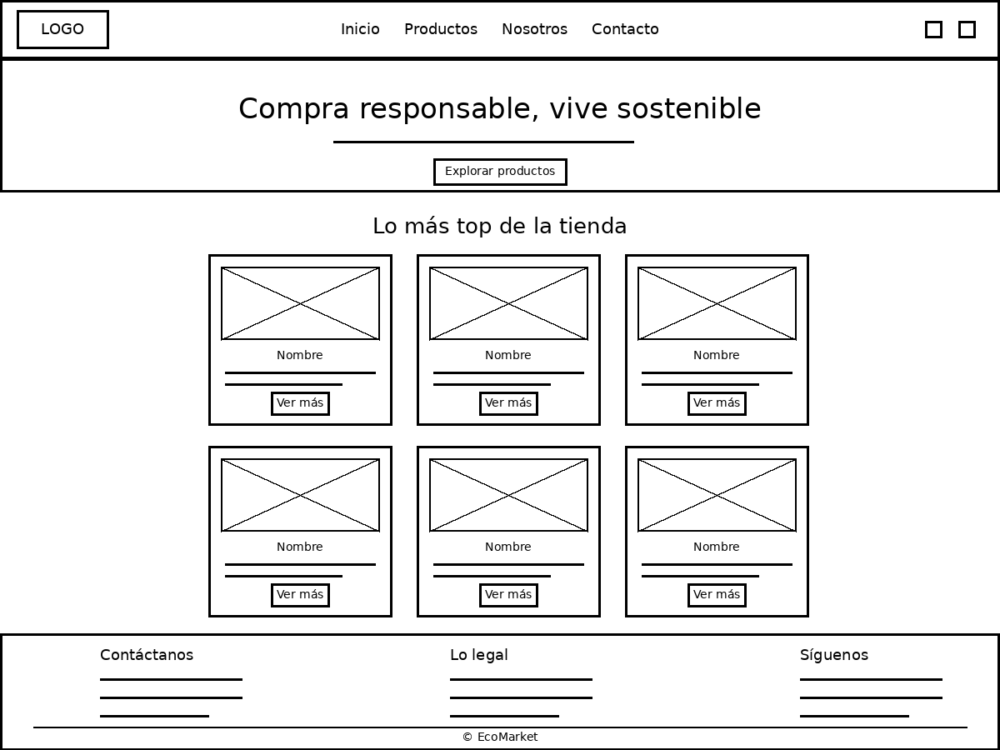

### Productos

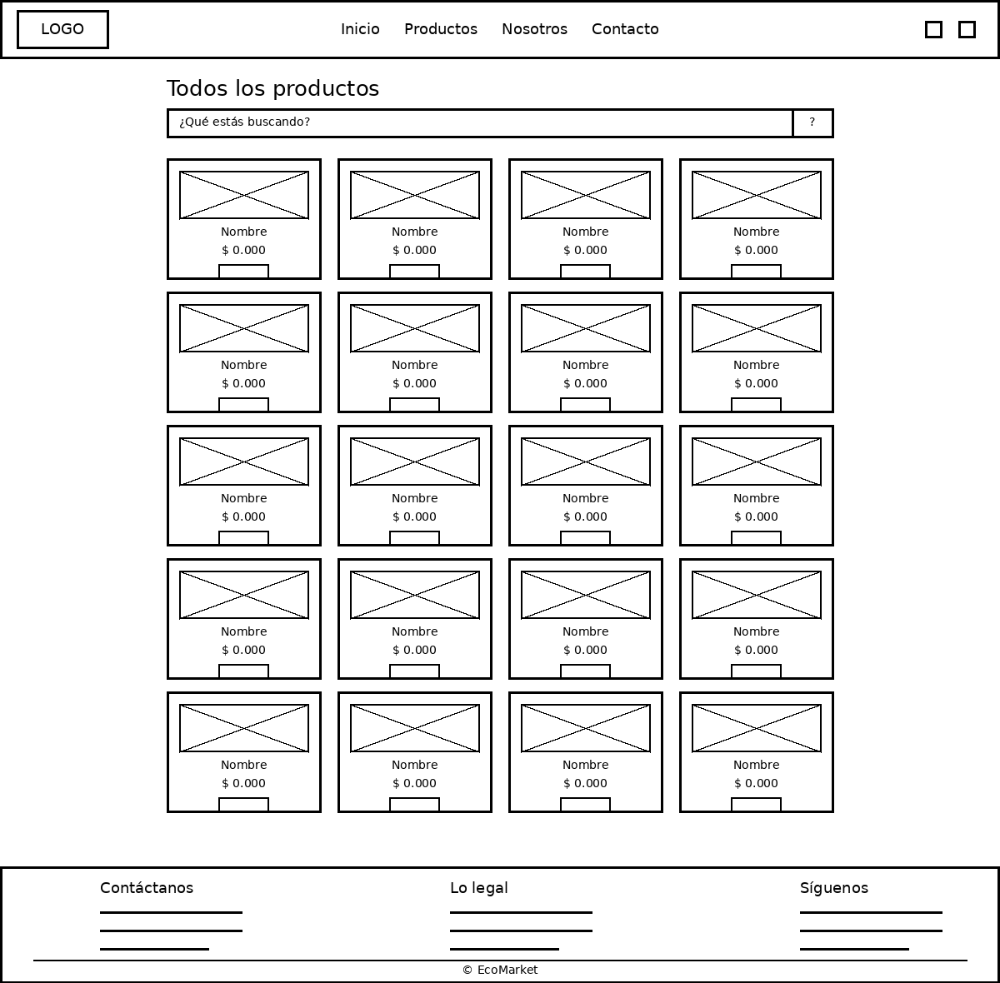

### Sobre nosotros

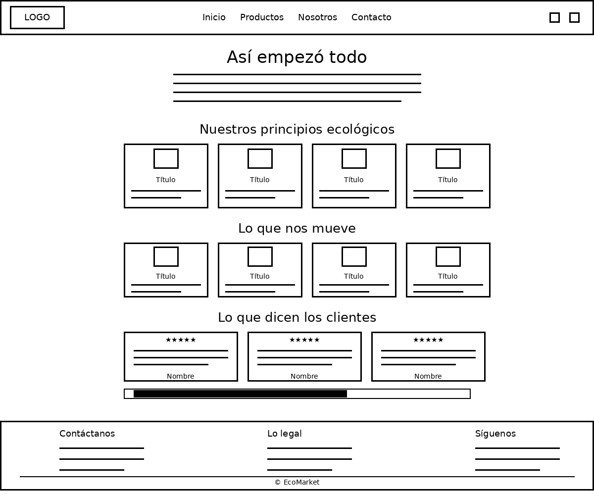

### Contacto

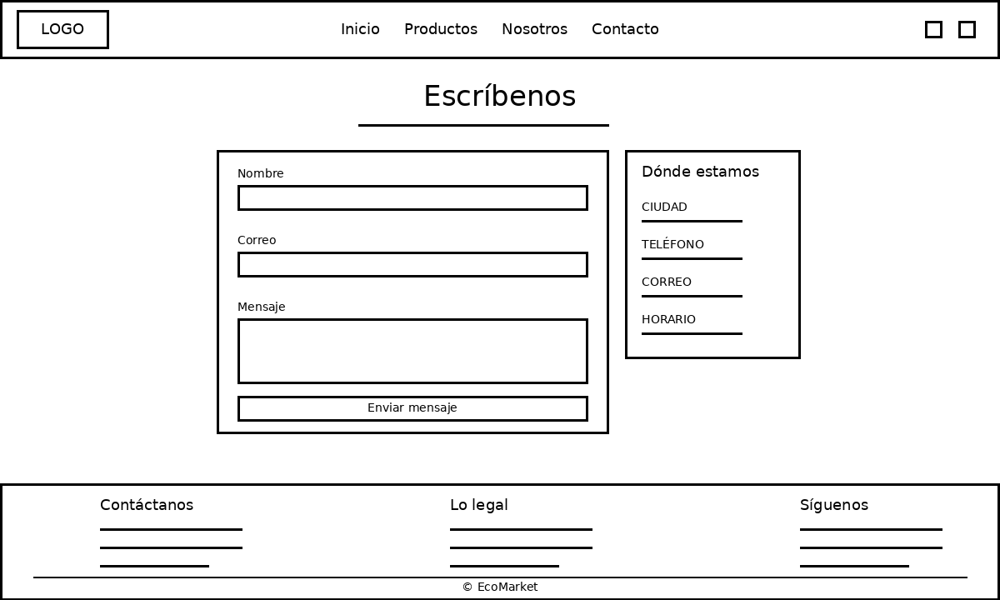

## Capturas

### Inicio

| Computador | Celular |
|---|---|
| 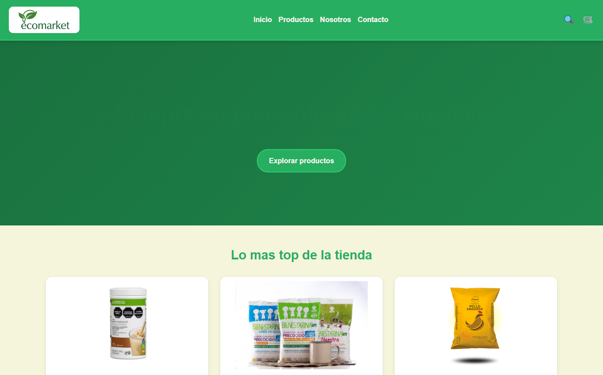 | 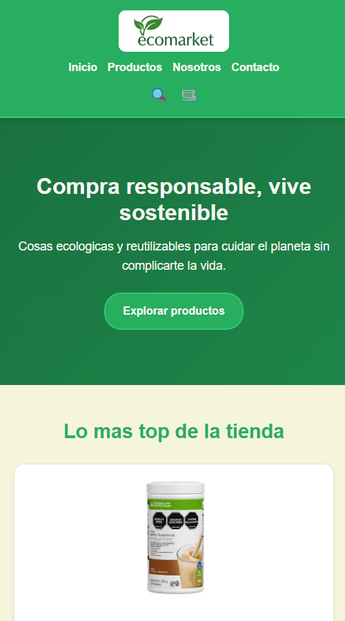 |

### Productos

| Computador | Celular |
|---|---|
| 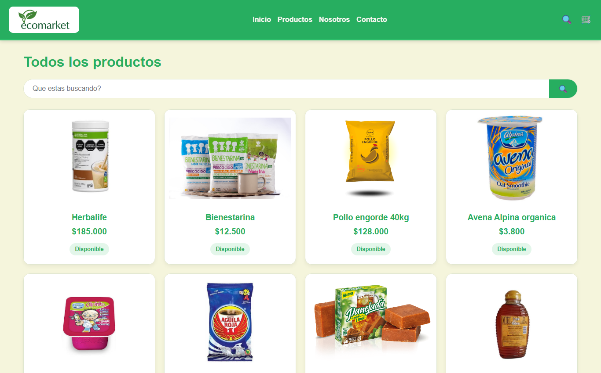 | 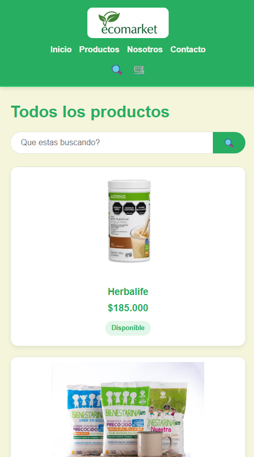 |

### Sobre nosotros

| Computador | Celular |
|---|---|
| 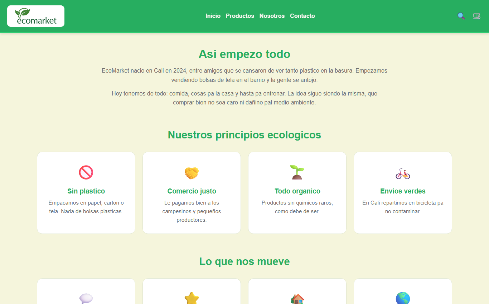 | 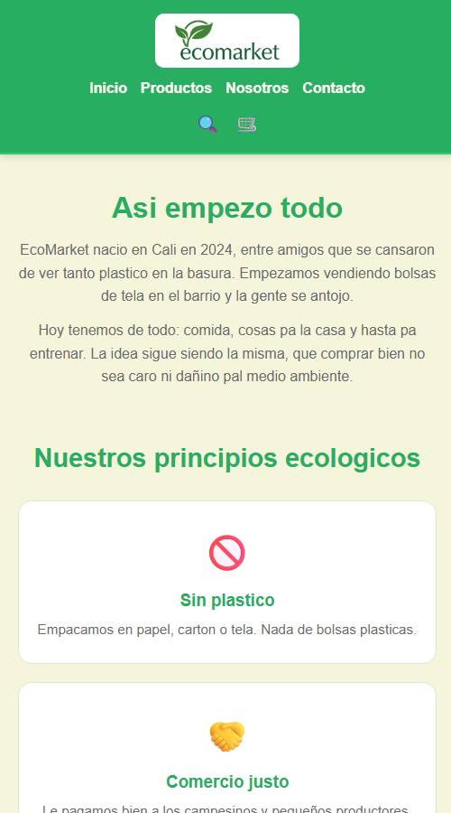 |

### Contacto

| Computador | Celular |
|---|---|
| 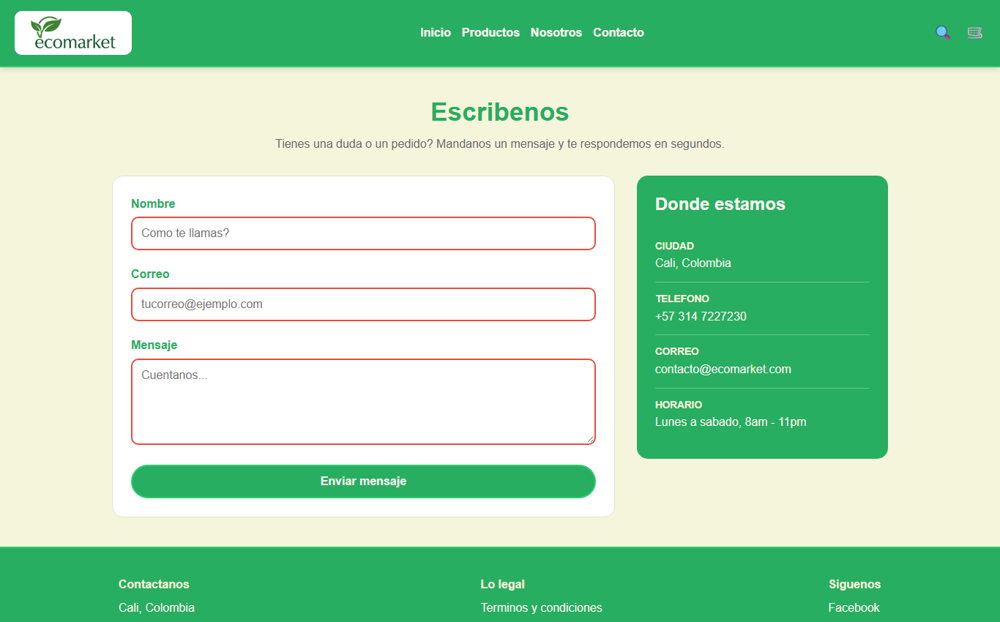 | 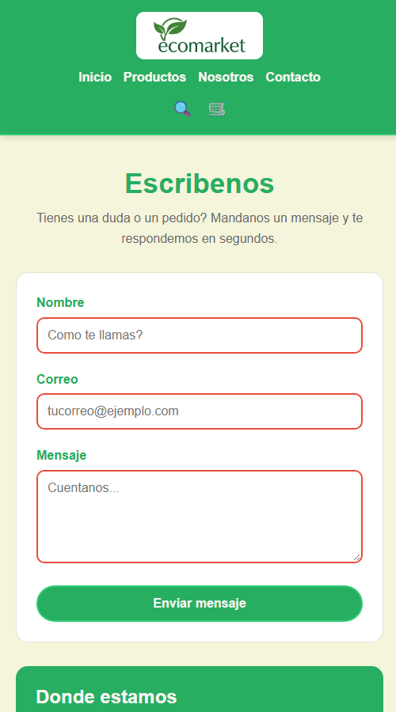 |

## Como la publique

La pagina se puede ver en internet aqui: **(aqui va el link cuando la publique)**

Para publicarla gratis en **Netlify** hice esto:

1. Entre a [netlify.com](https://www.netlify.com) e inicie sesion con mi cuenta de GitHub.
2. Le di a **Add new site** y luego **Import an existing project**.
3. Escogi **GitHub** y busque el repositorio `EcoMarket_Juan_Paz`.
4. No cambie nada de la configuracion, porque es solo HTML y CSS.
5. Le di a **Deploy** y en un ratico ya estaba en linea.

Cada vez que subo cambios a GitHub con `git push`, Netlify actualiza la pagina solita.

## Hecho por

Juan David Paz Santos ;)
